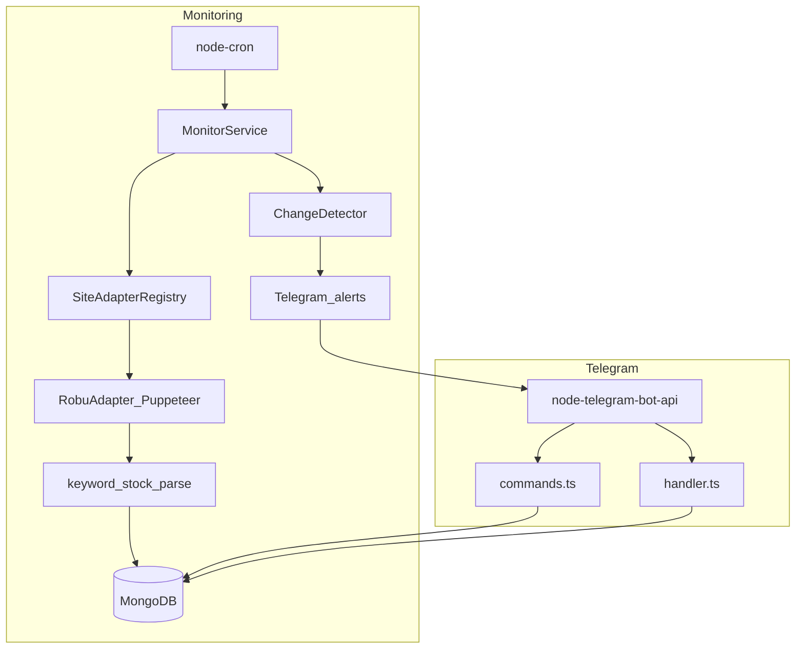

# Drone Parts Assistant

Lightweight take-home system that monitors **Robu.in** product pages for stock changes and exposes a **Telegram** bot for watchlist management, status queries, and alerts.

## Architecture



## Tech stack

- Node.js + TypeScript
- MongoDB + Mongoose
- Puppeteer (Robu.in scraping)
- node-telegram-bot-api
- node-cron
- Docker Compose

Stock status uses **keyword matching** on page text (no LLM). Natural language in the bot uses simple pattern matching.

## Setup

### Prerequisites

- Node.js 20+
- MongoDB (local or Docker)
- Telegram bot token from [@BotFather](https://t.me/BotFather)
- Your Telegram chat ID (`TELEGRAM_ALLOWED_CHAT_ID`)

### Local (without Docker)

```bash
cp .env.example .env
# Edit .env with your tokens

npm install
npm approve-scripts puppeteer
npx puppeteer browsers install chrome

# Start MongoDB locally, then:
npm start
```

### Docker Compose

```bash
cp .env.example .env
# Fill TELEGRAM_BOT_TOKEN and TELEGRAM_ALLOWED_CHAT_ID

docker compose up --build
```

The app container uses system Chromium (`PUPPETEER_EXECUTABLE_PATH`).

## Scripts

| Script | Description |
|--------|-------------|
| `npm start` | Connect DB, seed watchlist, start bot + cron |
| `npm run monitor:now` | One-shot monitor (no bot); `RUN_MONITOR_ONLY=1` |
| `npm run scrape -- <url>` | Test Robu scraper for one URL |
| `npm test` | Unit tests for keywords + change detection |
| `npm run build` | Compile TypeScript to `dist/` |

## Telegram usage

- `/start` — welcome + register for alerts
- `/watchlist` — tracked products + latest status
- `/check` — run monitor immediately
- Send a **robu.in** product URL — add to watchlist
- **"what is in stock?"** — list products whose latest snapshot is `in_stock`
- **"status of raspberry pi"** — latest snapshot for a name match

Alerts are sent when status changes **to** `in_stock` or `pre_order` (not on the first snapshot).

## Design decisions & trade-offs

| Decision | Why |
|----------|-----|
| **SiteAdapter + registry** | Add retailers without changing monitor/bot core |
| **Puppeteer for Robu.in** | Cloudflare + Next.js; plain `fetch` hits a challenge page |
| **Classic `node-telegram-bot-api@0.66`** | v2 dropped `new TelegramBot(..., { polling })`; 0.66 matches the take-home API |
| **Keyword stock detection** | Fast, deterministic, no API cost; breaks if copy/DOM changes |
| **MongoDB** | Flexible schema for snapshots history; easy Docker setup |
| **Single allowed chat ID** | Simple demo security; `users` collection supports many later |
| **No LLM in v1** | Interview PDF mentions LLM for noisy pages; Robu keywords are enough for scope |

## How to add a new site

1. Create `src/sites/yoursite.ts` implementing `SiteAdapter`:

```typescript
export const yourAdapter: SiteAdapter = {
  id: 'yoursite',
  hostname: 'example.com',
  async scrape(url) { /* return { name, price, status } */ },
};
```

2. Register in `src/sites/registry.ts`.
3. Extend bot URL validation in `handler.ts` and `commands.ts`.
4. Add seed URLs to `src/config/seed-watchlist.json` if desired.

Optional: introduce a `Notifier` interface to mirror Telegram for WhatsApp later.

## Known limitations

- Only **Robu.in** scraper is implemented.
- Stock detection depends on page text keywords.
- Robu.in sits behind Cloudflare; live scrapes need a real Chromium launch.
- If a live scrape fails, the product is recorded with status `unknown` and the error is logged. Canned seed-product fixtures are never used by default; set `ENABLE_FIXTURES=true` to opt in. Fixtures can report stale stock and price data, so do not enable them for real alerts.
- Product status name lookup uses case-insensitive substring matching, not fuzzy matching. For example, `"Pi 5"` matches `"Raspberry Pi 5"`, but `"pi5"` does not.
- Daily cron may miss same-day flash restocks (`MONITOR_CRON` is configurable).
- Single-user allowlist demo (`TELEGRAM_ALLOWED_CHAT_ID`).
- No WhatsApp (Meta Business API complexity).

## Seed watchlist (first run)

If the `products` collection is empty, the app inserts:

- Raspberry Pi 5 8GB (Robu.in)
- Official Raspberry Pi M.2 HAT+ for Pi 5 (Robu.in)
- Holybro Pixhawk 6X Standard Set v2A (Robu.in)

## Environment variables

See [`.env.example`](.env.example).
